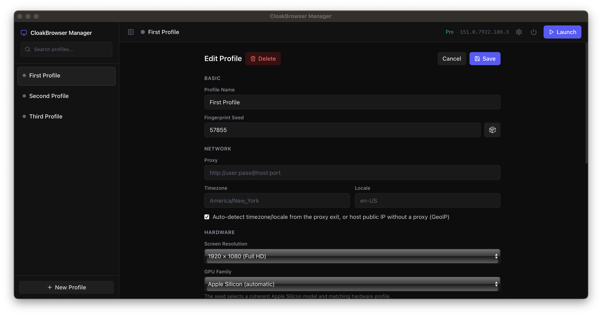

<p align="center">

</p>

<h3 align="center">Browser Profile Manager for CloakBrowser</h3>

> ### ⚠ This is an unofficial fork
>
> **CloakBrowser Manager (Custom)** is a personal fork of
> [CloakHQ/CloakBrowser-Manager](https://github.com/CloakHQ/CloakBrowser-Manager).
> It is **not** affiliated with, endorsed by, or supported by CloakHQ.
>
> - The code is MIT and the original copyright notice is preserved (see [LICENSE](LICENSE)).
> - The Chromium binary is **proprietary and is never bundled here** — it is downloaded
>   at first run using *your* CloakBrowser license key (see [BINARY-LICENSE.md](BINARY-LICENSE.md)).
> - No license keys are shared, resold, or multiplexed, and the **one-key-one-concurrent-browser**
>   seat limit is untouched: the key pool holds *your own* keys and hands exactly one
>   running browser each. Two browsers never share a key. There is no seat bypass and
>   no bulk launch.
> - For the supported product, install the [official release](https://github.com/CloakHQ/CloakBrowser-Manager/releases) instead.
>
> The installer uses its own AppId and its own data directory
> (`CloakBrowser Manager (Custom)`), so it can sit next to the official build
> without clobbering it.

<p align="center">
A self-hosted browser for managing unlimited accounts and profiles,<br>
each one a genuinely separate machine: its own fingerprint, GPU, proxy, cookies, and history.<br>
Powered by CloakBrowser, the stealth engine that passes Cloudflare Turnstile, reCAPTCHA v3, FingerprintJS and BrowserScan.<br>
The identities don't just look different. They hold up.
</p>

<p align="center">
Self-hosted alternative to Multilogin, GoLogin, and AdsPower.<br>
Start free with one concurrent browser, scale to more on a paid plan.
</p>

<p align="center">
<a href="https://github.com/CloakHQ/CloakBrowser"></a>
<a href="https://hub.docker.com/r/cloakhq/cloakbrowser-manager"></a>
<a href="LICENSE"></a>
</p>

---

<p align="center">

</p>

Open a profile and you don't get a new tab, you get a different computer: its own browser fingerprint, GPU, screen, timezone, proxy, cookies, and history. Nothing bleeds between profiles, so your accounts never link back to each other, or to you. Close a profile and reopen it next day, it's the same person, warmed up and ready.

Windows and macOS launch browsers directly in native desktop windows; Linux keeps the Docker/KasmVNC server experience.

### Windows and macOS

Download the installer from the [latest **official** release](https://github.com/CloakHQ/CloakBrowser-Manager/releases) and run it (this fork currently ships no binaries of its own):

- **macOS** — open the `.dmg` and drag **CloakBrowser Manager** into Applications. (Unsigned during early access — on first launch, run `xattr -rc "/Applications/CloakBrowser Manager.app"` in Terminal, or approve it under **System Settings → Privacy & Security → Open Anyway**.)
- **Windows** — run the setup `.exe`. (Unsigned during early access — if SmartScreen warns, click **More info → Run anyway**.)

No Python, Node, or git required. The Manager starts on `127.0.0.1:8090` and opens in your default browser. On first launch it downloads the CloakBrowser engine. Profiles are stored in `%LOCALAPPDATA%\CloakBrowser Manager` on Windows and `~/Library/Application Support/CloakBrowser Manager` on macOS; a `logs/manager.log` in that folder records what happened if you need it.

Open **Settings** (gear icon, top right) to add your license key to the pool and pick the Stable or Preview channel.

#### Run from source (developers)

```bash
git clone https://github.com/CloakHQ/CloakBrowser-Manager.git
cd CloakBrowser-Manager
./run-macos.sh      # macOS  (or run-windows.bat on Windows)
```

This path requires Python 3.10+ and Node 18+; the first run creates a local Python environment, installs dependencies, and builds the React UI before starting the Manager.

### Linux server

```bash
docker run -p 127.0.0.1:8090:8090 -v cloakprofiles:/data cloakhq/cloakbrowser-manager
```

Or build from source:

```bash
git clone https://github.com/CloakHQ/CloakBrowser-Manager.git
cd CloakBrowser-Manager
docker compose up --build
```

Open [http://localhost:8090](http://localhost:8090), create a profile, and click Launch.

> **Early alpha** — this project is under active development. Expect bugs. If you find one, please [open an issue](https://github.com/CloakHQ/CloakBrowser-Manager/issues) and attach the log so we can help. On Windows/macOS it's `logs/manager.log` in the data folder (`%LOCALAPPDATA%\CloakBrowser Manager` / `~/Library/Application Support/CloakBrowser Manager`); on Linux/Docker use `docker logs <container>`.

## CloakBrowser license key

The Manager runs on the CloakBrowser engine, so it needs a key.<br>
[Get a free one by email](https://cloakbrowser.dev/free) to run one profile at a time on the current build.<br>
[Paid plans](https://cloakbrowser.dev) raise how many profiles run at the same time, from a handful to thousands.

Add your key once to the **key pool** — every launch leases a key from it (see below).

**Native app (Windows/macOS):** open **Settings** (gear icon, top right), add your key to the pool, choose the Stable or Preview channel, and Save. It applies immediately, no restart. The badge in the top bar shows which tier and binary version are active.

**Docker:** open **Settings** (gear icon, top right) the same way, add your key, and Save. It applies immediately and is stored in the mounted `/data` volume, so it persists across restarts and image updates. For automated or headless setups, pass it at `docker run` instead:

```bash
docker run -p 127.0.0.1:8090:8090 -v cloakprofiles:/data \
  -e CLOAKBROWSER_LICENSE_KEY=cb_your_key_here \
  -e CLOAKBROWSER_RELEASE_CHANNEL=preview \
  cloakhq/cloakbrowser-manager
```

**Run from source (or `docker compose`):** set it in a manager-root `.env`:

```bash
cp .env.example .env
```

```bash
# .env
CLOAKBROWSER_LICENSE_KEY=cb_your_key_here
CLOAKBROWSER_RELEASE_CHANNEL=stable   # or: preview
```

The file is loaded automatically at startup (`docker compose` reads it too); restart the Manager after changing it. A key passed this way is seeded into the pool at startup, so it behaves like any other pooled key — if you later add the same key again by hand, it is not duplicated.

### Key pool: one key per concurrent profile

A free key allows **one concurrent browser**: launch a second profile on the same
key and the license server denies it. That denial is not a bug in the Manager —
it is the plan working as sold.

To run N profiles at once you need N keys, each from its own account. Add them in
**Settings → Key pool**, one per line; they are validated on add, so a dead key is
caught while you are still looking at the list rather than as a failed launch
later.

| Situation | Keys needed |
|-----------|-------------|
| One profile at a time | 1 |
| 5 profiles running together | 5, one leased per profile |
| 20 profiles, 5 at a time | 5 — keys are released when a profile stops |

How leasing works:

- A launch leases the profile's **pinned** key if it has one, otherwise the first
  free key in the pool. A key handed over by environment/file counts as a pool
  key too (see above).
- A key is reserved for as long as its browser runs. **Stopping** a profile hands
  the key straight back. A browser that **dies** (crash, window closed, killed) or
  a launch that **fails** does not: the license server keeps counting that
  abandoned session for a while (4 minutes on free, 15 on team, 30 on business),
  so the key cools down for that window before the pool may hand it to anyone
  else. The pool asks the license server, which costs no seat, and releases the
  key early the moment the server reports the seat free — the full window is only
  the fallback when the server cannot be asked. The key list shows `cooling down`
  while that lasts.
- If every key is already leased, the launch is refused **before** the browser
  starts, with the same "session limit reached" message the server would have
  produced a second later — plus how long the earliest cooling key still needs.
  Nothing is left half-started.
- A key the binary rejects (exit code 77: invalid or expired) is marked invalid
  and drops out of rotation. An *out of seats* denial (76) does not retire the
  key — it is healthy, just busy.
- The pool is stored in `keys.json` next to the database, readable only by the
  Manager. The API and UI only ever see a masked form (`cb_ab…wxyz`) and a short
  id; the raw key never leaves the server.

Pinning a key to a profile (in the profile form) reserves that key for it, so a
pooled key cannot be consumed by whichever profile happens to launch first.

**Each key gets its own device identity.** The Pro binary stamps every session
with a device id (`~/.cloakbrowser/install_id`). Left alone, all your keys report
the same id and the server sees one machine running several keys — exactly what a
farming ring looks like. The Manager therefore derives a stable UUID per key and
writes it just before that key's browser starts, so the server sees each key on
its own machine. The machine's own id is kept in `~/.cloakbrowser/install_id.machine`
and restored right after the check-in, so a keyless launch — or the binary run by
hand — keeps the real machine id instead of inheriting the last key's, even if a
crash left the file mid-swap. Changing the pool or restarting does not shuffle
ids: they are a pure function of the key.

**The exit IP is spoofed too.** By default the license/session calls go straight
to cloakbrowser.dev, which would still expose your real IP for every key. On a
proxied profile the Manager adds `--license-route=proxy` so those calls leave
through the profile's own proxy and each key checks in from its own exit IP. This
needs a binary that understands the flag (155+); where the wrapper would leave the
proxy in Playwright, the Manager passes `--proxy-server` itself, so SOCKS5,
HTTP-with-credentials and plain no-auth `http://host:port` proxies all work.

**WebRTC does not leak the real IP either.** A proxy does not cover STUN, so a
page could read the host's own address and correlate two keys. Proxied profiles
ask the wrapper to report the proxy's exit IP over WebRTC instead
(`--fingerprint-webrtc-ip=auto`); if the lookup fails the flag is dropped and the
real candidates show, and an explicit `--fingerprint-webrtc-ip` in the profile's
launch arguments wins.

**Keys do not create identities.** Each key is a seat, not a fingerprint: profiles
that must look unrelated still need their own proxy and their own browser process.
Five keys behind one IP are five browsers that the target site can still correlate.

## Why Not a Cloud Anti-Detect Browser?

The popular anti-detect browsers solve the fingerprint, then hand you a new problem: every account you own, every cookie, every session, sits on someone else's servers. And the disguise increasingly doesn't survive real detection, shortcuts in how fingerprints are faked, GPU and WebGL values that don't add up, identities that pass a test page and fail the real site.

CloakBrowser Manager runs on your own machine, and every profile inherits the CloakBrowser engine, so the identities actually hold up.

| | Typical cloud anti-detect browser | **CloakBrowser Manager** |
|---|---|---|
| Pricing model | Per profile + per seat, forced up-tiering | **Flat by concurrency, unlimited profiles** |
| Where profiles live | Their cloud | **Your machine** |
| Fingerprinting | JS-injected into a stock browser | **Source-level C++ patched engine** |
| The app | Closed box | **Open-source GUI (MIT)** |
| Native desktop windows | Rare | **Windows + macOS** |
| Automation API | Add-on / higher tier | **CDP built in, every profile** |
| Cost of idle accounts | Counts against your limit | **Free** |

## Features

- **Unlimited profiles, no per-profile tax** — create as many identities as you want. You pay only for how many run at the same time, not how many you keep. Dormant accounts cost nothing.
- **Each profile is a different machine** — its own fingerprint seed, GPU family, screen, cookies, localStorage, cache, and history, persistent across restarts
- **Per-profile network and locale** — proxy, GeoIP, timezone, locale, and screen, per profile; timezone and language follow the proxy exit IP automatically
- **Rotating proxy providers** — pull a fresh proxy from KiotProxy or TMProxy on every launch, keep one IP until it expires, or rotate only on demand; the Manager respects each provider's cooldown
- **Platform-aware hardware profiles** — automatic Apple Silicon selection and configurable Windows GPU families, coherent within each profile
- **Profile organization** — create, search, tag, edit, auto-launch, and delete profiles
- **Duplicate with browser state** — clone a profile with just its settings, or together with its cookies, logged-in sessions, and storage
- **Profile files** — send files to a profile and, on a Linux server, keep everything its browser downloads
- **Platform-native browsing** — Windows and macOS profiles open in normal desktop windows
- **Linux server viewing** — interact with Docker-launched browsers through KasmVNC in the web GUI
- **Playwright/Puppeteer API** — connect to any running profile through CDP while watching the same session live
- **Humanized interaction** — optional human-like mouse, keyboard, and scrolling behavior
- **Compatibility controls** — unpacked extensions, third-party-cookie support, and advanced Chromium arguments
- **Clipboard sync** — copy and paste between the Manager and Linux VNC browser profiles
- **License and system status** — see the active tier, binary version, and Windows font health in the top bar
- **Optional authentication** — protect the web UI and API with a single token, or run locally without authentication
- **Powered by CloakBrowser** — the identities don't just look different, they hold up: a source-level C++ patched Chromium engine tested against Cloudflare Turnstile, reCAPTCHA v3, FingerprintJS, and BrowserScan

## Stack

- **Backend**: FastAPI (Python)
- **Frontend**: React + Tailwind CSS
- **Browser viewer**: native windows on Windows/macOS; noVNC/KasmVNC on Linux Docker
- **Database**: SQLite
- **Browser engine**: [CloakBrowser](https://github.com/CloakHQ/CloakBrowser) (stealth Chromium binary)

## Development

### Native backend

```bash
python -m venv .venv && source .venv/bin/activate
pip install -r backend/requirements.txt
uvicorn backend.main:app --reload --host 127.0.0.1 --port 8090
```

### Frontend

```bash
cd frontend
npm install
npm run dev
```

### Docker

```bash
docker compose up --build
```

## Requirements

- Windows or macOS native: Python 3.10+, Node.js 18+
- Linux server: Docker 20.10+
- ~2 GB disk (application + browser binary)
- ~512 MB RAM per running profile

## Updating

### Windows and macOS

Pull the latest source and run the platform launcher again. It installs changed dependencies and rebuilds the interface automatically.

```bash
git pull
```

```text
Windows: run-windows.bat
macOS:   ./run-macos.sh
```

### Linux server

Pull the latest image and recreate the container:

```bash
docker pull cloakhq/cloakbrowser-manager
docker stop <container-id>
docker rm <container-id>
docker run -p 127.0.0.1:8090:8090 -v cloakprofiles:/data cloakhq/cloakbrowser-manager
```

Profiles and session data remain in the native application-data directory or the `cloakprofiles` Docker volume across updates.

## Automation API

Every running profile exposes a CDP (Chrome DevTools Protocol) endpoint. Connect Playwright or Puppeteer to automate a profile while watching it live in the browser.

```python
from playwright.async_api import async_playwright

async with async_playwright() as pw:
    browser = await pw.chromium.connect_over_cdp(
        "http://localhost:8090/api/profiles/<profile-id>/cdp"
    )
    page = browser.contexts[0].pages[0]
    await page.goto("https://example.com")
```

```javascript
const { chromium } = require("playwright");

const browser = await chromium.connectOverCDP(
  "http://localhost:8090/api/profiles/<profile-id>/cdp"
);
const page = browser.contexts()[0].pages()[0];
await page.goto("https://example.com");
```

The CDP URL is available from the running-profile view. The same browser session is accessible through its native window on Windows/macOS or through VNC on Linux Docker, and programmatically through the API on every platform.

## Profile files

A profile can exchange files with the outside world. This matters most under Docker, where the
browser cannot see your filesystem: a file you want to upload to a website is not reachable from
the guest's file dialog, and anything the browser downloads is trapped in the container.

```bash
# Put a file where the profile's browser can use it: the body is the file, the header its name
curl --data-binary @report.csv -H "X-File-Name: report.csv" http://localhost:8090/api/profiles/<id>/files

# What this profile holds
curl http://localhost:8090/api/profiles/<id>/files

# Fetch one back (also serves what the browser downloaded)
curl -OJ http://localhost:8090/api/profiles/<id>/files/<artifact-id>

curl -X DELETE http://localhost:8090/api/profiles/<id>/files/<artifact-id>
```

The upload body is the file itself, not a form: it streams straight into the profile's store,
so a file costs one copy on disk and an oversized one is refused from its `Content-Length`
before a byte is read. `X-File-Name` is URL-encoded (`%20` for a space), though a raw UTF-8 name
works too; the stored type is the request's `Content-Type` when it is a real one, otherwise a
guess from the name. An upload
reports a `container_path`, which is what a CDP call that takes a path
(`DOM.setFileInputFiles`, `Input.dispatchDragEvent`) hands to the page.

In the Docker build the live viewer gains a files button: upload from your own machine, drop a
file straight onto the screen, or pull one back. Uploaded files also appear in the guest's own
file dialog under **Uploads — <profile>** in the sidebar, so a website's "Choose file" button can
reach them, and files the browser downloads are captured automatically and land in the same list.

On the native macOS and Windows builds the browser already shares your filesystem and writes to
your own Downloads folder, so neither the sidebar shortcut nor download capture applies there.
The endpoints above still work.

Download behaviour is browser-wide and last-writer-wins, so an automation client attached to the
profile's CDP endpoint controls it: Playwright's `connect_over_cdp`, for example, sets its own
download directory (or disables downloads entirely) as it initialises. While such a client is
attached its downloads go where it asked, not into the profile's files — the Manager records
nothing it cannot see, and never cancels a transfer it does not own. When such a client
disconnects, Chromium falls back to its default download behaviour rather than to the Manager's,
so capture is re-armed as soon as a proxied CDP connection closes.

Files live beside the profile, not inside it, so duplicating a profile's browser state never
copies its documents. Deleting a profile deletes its files. Nothing expires on its own: the
limits below are per profile. A file larger than `ARTIFACT_MAX_BYTES` is refused with `413`, and
an upload that would breach a profile's count or total is refused with `507`; nothing is evicted
to make room.

| Variable | Default | Meaning |
| --- | --- | --- |
| `ARTIFACT_MAX_BYTES` | `268435456` (256 MiB) | Largest single file |
| `ARTIFACT_MAX_COUNT` | `200` | Files per profile |
| `ARTIFACT_MAX_TOTAL_BYTES` | `2147483648` (2 GiB) | Total per profile |

## Remote Access

The container binds to localhost only. To access from a remote server:

```bash
ssh -L 8090:localhost:8090 your-server
```

Then open `http://localhost:8090`.

## Authentication

By default, there is no authentication (ideal for local use). To protect the web UI and API when hosting on a network, set the `AUTH_TOKEN` environment variable:

```bash
docker run -p 127.0.0.1:8090:8090 -v cloakprofiles:/data -e AUTH_TOKEN=your-secret-token cloakhq/cloakbrowser-manager
```

Or in `docker-compose.yml`:

```yaml
environment:
  - AUTH_TOKEN=your-secret-token
```

When `AUTH_TOKEN` is set:

- The web UI shows a login page. Enter the token to unlock.
- API consumers pass the token via `Authorization: Bearer <token>` header.
- VNC WebSocket connections are authenticated via the login cookie.
- The `/api/health` endpoint remains unauthenticated (for Docker healthcheck); it exposes no system details. The `/api/status` endpoint (running counts, version) now requires authentication.

> **Note**: The auth token is transmitted in cleartext over HTTP. If you expose the Manager to the internet, put it behind a reverse proxy with HTTPS (Caddy, nginx, Traefik).

## License

- **This application** (GUI source code) — MIT. See [LICENSE](LICENSE).
- **CloakBrowser binary** (compiled Chromium) — governed by version-specific subscription terms and may not be redistributed. See [BINARY-LICENSE.md](BINARY-LICENSE.md).

The GUI application requires the CloakBrowser Chromium binary to function. The binary is automatically downloaded once you add a license key and is governed by its own license terms. If you fork or redistribute this application, your users must comply with the [CloakBrowser Binary License](BINARY-LICENSE.md).

## Contributing

Contributions are welcome. Please [open an issue](https://github.com/CloakHQ/CloakBrowser-Manager/issues) first to discuss what you'd like to change.

### Contributors

- [lhq1363511234-arch](https://github.com/lhq1363511234-arch) — native Windows support foundation
- [quorentindupres-dev](https://github.com/quorentindupres-dev) — native macOS workflow and Manager integration concepts
- [shellus](https://github.com/shellus) — auth-gated status endpoint and unauthenticated health probe, offline VNC startup
- [hayka-pacha](https://github.com/hayka-pacha) — profile reset endpoint
- [theaafofficial](https://github.com/theaafofficial) — duplicating a profile with its browser state, and per-profile files with download capture

## Links

- **CloakBrowser** — [github.com/CloakHQ/CloakBrowser](https://github.com/CloakHQ/CloakBrowser)
- **Website** — [cloakbrowser.dev](https://cloakbrowser.dev)
- **Bug reports** — [GitHub Issues](https://github.com/CloakHQ/CloakBrowser-Manager/issues)
- **Contact** — cloakhq@pm.me
